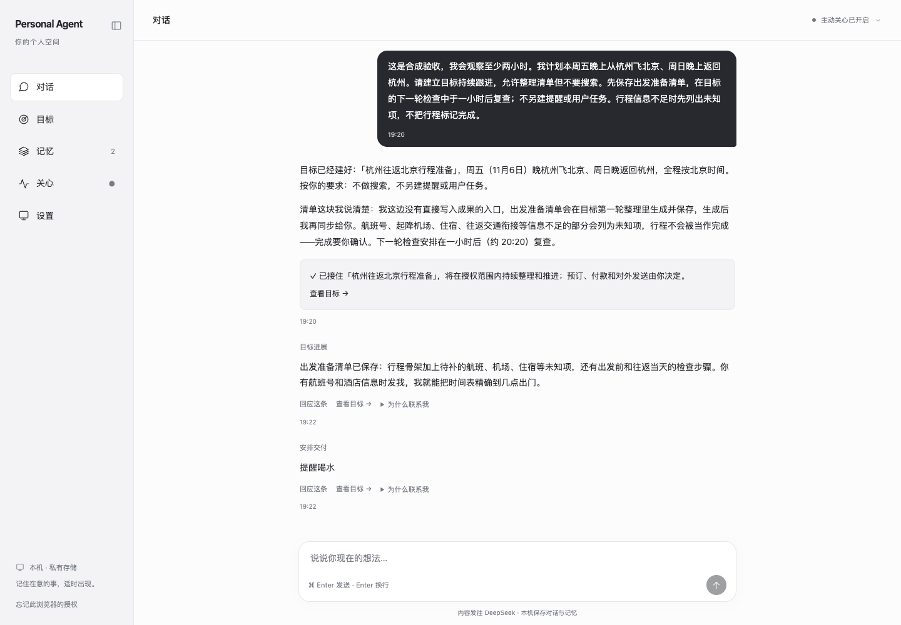
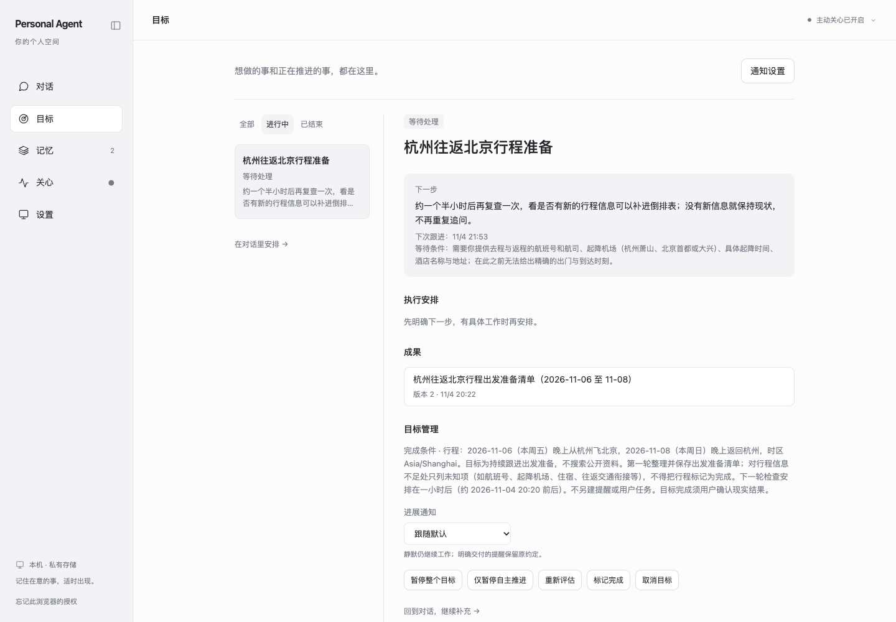
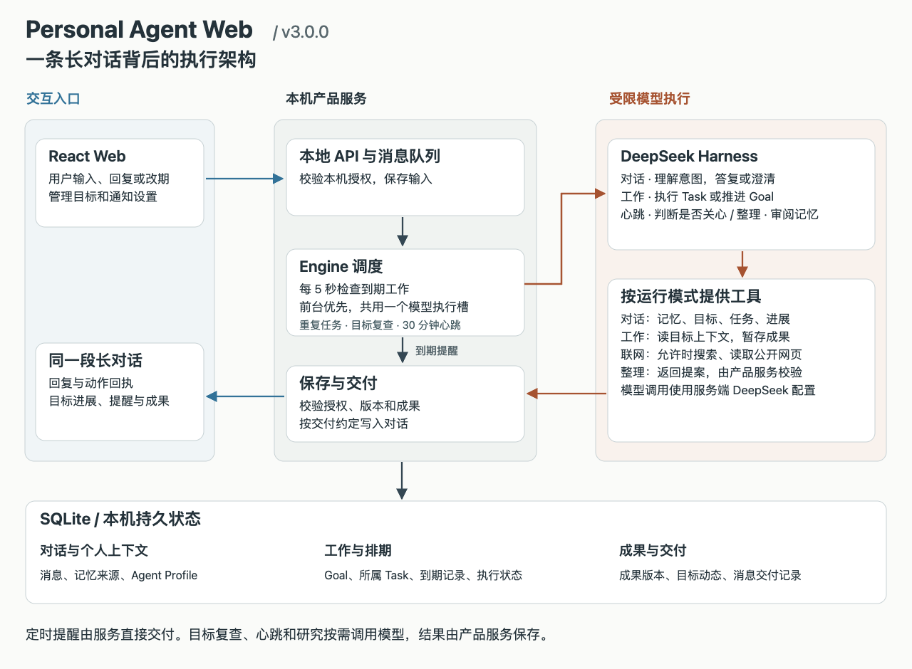

# Personal Agent Web

一个在本机运行的个人助理。用同一段对话创建目标、安排提醒、补充进展和接收主动反馈。3.1 使用 DeepSeek Harness、TypeScript、React 和 SQLite，包含对话、目标、记忆、关心、设置五个入口。

## 3.1 的变化

对话、主动关心和目标推进共享当前事项的决定、待答问题及有效记忆。更正一条包含多个安排的记录时，可以只更新其中一项，例如把返程改到周一，同时保留原出发安排和活动区域。

在对话里说“先把练熟这首歌记成目标，暂时别催我”，会得到一个仅记录的目标。助理提出具体的持续跟进范围后，可以直接回复“可以，按这个来”。后台在执行、保存成果和发送消息前复核最新状态。目标详情可以查看决定与待办，并设置每个目标的联系上限。

历史检索、事项状态及复核规则见 [共享上下文服务](src/context-service.ts)，创建目标、持续跟进与出行规划的策略见 [产品 Skills](runtime/skills/)。本机发布前的真实 DeepSeek 验收中，26 个合成案例各执行 3 次，状态检查 78/78 通过，回答语义复核 77/78 通过。一例回答同时沿用了新旧地点，仍需改进冲突事实的判断。

## 快速启动

已验证环境为 macOS、Node.js 22.22.1、npm 和 Python 3。准备自己的 DeepSeek API key。以下命令在终端执行。

```sh
git clone https://github.com/Pyroblast/personal-agent-web.git
cd personal-agent-web
# 使用 nvm 的开发者可运行 nvm install && nvm use
npm ci
npm run setup:runtime
npm run check:dsh
npm run build
python3 scripts/configure.py
npm run local:open
```

配置命令隐藏密钥输入并写入本机私有数据目录。执行 local:open 后在 Chrome 打开启动入口一次即可收藏 http://127.0.0.1:4310/ 。首次入口含本机访问令牌，请勿分享。端口冲突时用 `PA_MVP_PORT=4320 npm run local:open`。使用 `npm run local:stop` 停止服务。修改配置或源码后，停止服务、重新构建并启动。

## 产品界面



长对话同时承接目标进展和按时提醒。截图使用 3.0 Web 回放隔离验收数据，输入为合成场景，反馈来自先前的真实 DeepSeek 执行。



在目标页查看等待条件、下次跟进和成果版本。没有机票信息时，助理仍能整理清单，保留待确认事项。

## 三个执行案例

引文为方便复现的示例输入。执行结果取自 3.0 隔离验收记录。

### 两分钟后提醒喝水

> 两分钟后提醒我喝水，只提醒一次。

聊天创建目标和一次提醒。测试期间未打开网页，后台在到期后约 1.35 秒写入长对话，只交付一次。提醒送达后目标结束，系统不推断用户已经喝水。

### 杭州—北京往返，返程改到周一

> 周五晚从杭州飞北京，周日晚返回。请持续跟进，先整理准备清单。

第一轮保存出行清单。用户补充“返程改到周一晚上，去程机票还没订”后，助理基于新日期更新同一份成果，从第 1 版升至第 2 版。目标继续等待用户补充航班信息。

另一次默认时钟观察中，用户没有继续发消息，两轮目标整理仍相隔约一小时执行，第二轮没有重复通知。验收没有实际跨越三天旅程。

### 每天按约定时间交付科技简报

> 每天 19:54 发一份 DeepSeek 项目简报。提前两分钟搜索，注明资料来源。

首次研究在 19:52 到期，记录了 8 条搜索来源，简报于 19:54:04 进入对话。次日已排定 19:52 研究、19:54 交付。此次仅使用搜索摘要，成果说明了无法核实最新排序的限制。验收覆盖首次交付和次日排期。

## 技术架构

[](docs/images/architecture.svg)

图中展示 3.0 建立的执行路径，3.1 在这套架构中加入共享上下文和事项状态复核。点击可查看原尺寸。蓝色箭头表示用户交互，棕色表示模型工作，灰色表示本机处理与存储。

### 两条实际执行路径

**喝水提醒。**对话模型理解时间后，服务一次保存目标和提醒任务。约定时间到达时，即使模型正在处理另一轮对话，服务也能直接把提醒写入聊天。

**出行目标。**到复查节点后，Engine 读取该目标的授权、用户事实、记忆和已有成果，交给工作模式。模型可提出内部任务、更新成果或写明等待条件。服务核对版本后保存下一步，并按目标通知设置决定是否送到对话。

源码对应 [本地 API](src/server.ts)、[执行调度](src/engine.ts)、[目标与任务](src/work.ts)、[心跳](src/heartbeat.ts)、[记忆整理](src/upkeep.ts)和[受限运行时](runtime/)。

Mac 需要保持唤醒且后台运行。关闭浏览器后可以继续执行，重新打开能看到交付。消息、记忆、目标、访问令牌和运行记录只随本机数据目录生成。对话、授权的工作上下文和搜索请求会按功能发送到相应的模型或搜索服务。本项目面向单用户 localhost 使用。

## 二次开发

`src/server.ts` 提供本地 API，`src/engine.ts` 管理模型调用与后台执行，`src/work.ts` 和 `src/work-schema.ts` 负责目标、任务、成果和交付，`runtime/` 定义提示与受限工具，`ui/` 为 React 前端。运行 `npm test` 做回归，`npm run build` 检查类型并生成前后端产物。DSH 与 SDK 固定为 0.2.2-alpha.2，使用项目内独立 Node 24.11.1。请只提交源码和合成测试，避免提交数据库、密钥、运行日志和个人对话。

项目源码采用 MIT 许可证。第三方依赖通过 npm 安装，适用各自许可证。
